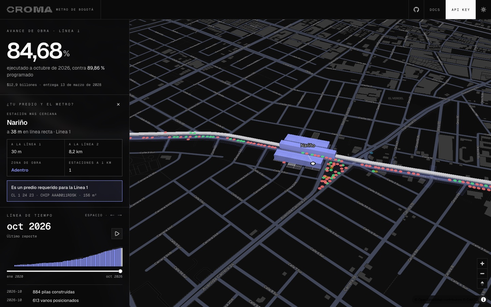

<div align="center">

<picture>
  <source media="(prefers-color-scheme: dark)" srcset="public/croma_brand_white.svg">
  
</picture>

# Metro de Bogotá

**Line 1 of the Bogotá metro in 3D, month by month, and what it means for any address.**

A map of the Bogotá metro built on the [Croma API](https://docs.usecroma.com/guides/colombia/metro-bogota): the viaduct and its 16 stations standing over the city, how far the works have come each month since 2020, every tree the works touched, and for any point in the city the nearest station, the distance to each line, and whether it is one of the parcels Line 1 needs. Six endpoints and one API key.

**[Open the map →](https://metro.usecroma.com)**

[](https://vercel.com/new/clone?project-name=metro-bogota-live&repository-name=metro-bogota-live&repository-url=https%3A%2F%2Fgithub.com%2Fcroma-labs%2Fmetro-bogota-live&env=CROMA_API_KEY&envDescription=CROMA_API_KEY+reads+the+Bogot%C3%A1+metro+through+Croma+%28free+to+get%29.&envLink=https%3A%2F%2Fplatform.usecroma.com%2Fsign-up)
&nbsp;
[](https://platform.usecroma.com/sign-up)

<br />



</div>

---

## What's inside

- **The metro in 3D**: Line 1's viaduct raised over the street, its 16 stations and their access buildings, and the Patio Taller depot, extruded from the official shapes. Line 2's route and 11 stations are drawn dashed, since they are still in design.
- **Any point in the city**: click anywhere, or use your location. The answer from `proximity` says the nearest station and how far it is, the distance to Line 1 and to Line 2, whether the point is inside the works area, and whether it falls on one of the 1,427 parcels Line 1 requires (with its CHIP, address and area).
- **The works, month by month**: a time slider from January 2020 to the latest report, with executed against planned progress for the whole of Line 1, the project's milestones, and every tree the works moved, cut, treated or kept appearing on the map the month it happened. Press play to watch it run.
- **Required parcels and the works area**: the parcel outlines show from zoom 13, the works area as a dashed outline.
- **Recording mode**: press `R`. The panels go, the camera tilts over the whole line and turns slowly, and a large progress counter takes the corner. Press space to play the works from 2020.
- **A live API inspector**: every call the server makes, its status and latency, and a ready-to-run cURL.
- **One copy for everyone**: the network, the progress, the trees and the parcels are read once every six hours and shared by every visitor. Point checks are cached for a day per 10 m. The API key never reaches the browser.
- **Validated end to end**: Zod checks every query parameter before it reaches the API and every API response before it reaches the map.
- **Crafted UI**: [shadcn/ui](https://ui.shadcn.com) on the same ruled-sheet design system as [TransMilenio en vivo](https://github.com/croma-labs/transmilenio-live). The map is [MapLibre](https://maplibre.org) on CARTO basemaps, in dark and light, on desktop and mobile.

## One-click deploy

1. Click **Deploy with Vercel** above.
2. Grab a free API key with the **Get your Croma API key** button (sign-up takes a minute).
3. Paste your `CROMA_API_KEY` when Vercel asks for env vars.
4. Done. Your map is live.

## Running locally

```bash
git clone https://github.com/croma-labs/metro-bogota-live
cd metro-bogota-live
npm install

cp .env.example .env.local
# fill in CROMA_API_KEY

npm run dev
```

Open [http://localhost:3000](http://localhost:3000), click near any station, then press `R` and space.

## Environment variables

| Variable                   | Required | Description                                                                              |
| -------------------------- | -------- | ---------------------------------------------------------------------------------------- |
| `CROMA_API_KEY`            | yes      | Reads the metro through Croma. [Get one free →](https://platform.usecroma.com/sign-up)   |
| `CROMA_API_URL`            | optional | API base override. Defaults to `https://api.croma.run`.                                  |
| `UPSTASH_REDIS_REST_URL`   | optional | Limits point checks per IP. [Upstash Console →](https://console.upstash.com/)            |
| `UPSTASH_REDIS_REST_TOKEN` | optional | Pairs with the URL above.                                                                |

## How it works

```
app/api/network/route.ts     Stations and infrastructure (alignments, viaduct, works area, access buildings, depot)
app/api/progress/route.ts    Monthly progress, stages and milestones
app/api/trees/route.ts       The tree inventory, every page
app/api/parcels/route.ts     The required parcels, every page
app/api/check/route.ts       One point against the metro
lib/metro.ts                 The calls to Croma, and the copies every visitor shares
lib/croma.ts                 POST to Croma, validate with Zod, record a trace for the inspector
lib/schemas.ts               Zod schemas for every response and query parameter
components/metro-map.tsx     The map: 3D layers, the month filter, the picked point, camera
components/metro-app.tsx     Page state: timeline, point check, layers, recording mode, mobile layout
components/panels.tsx        Progress counter, point check, timeline, layers, stations, inspector
```

The calls behind it:

| Endpoint                                         | Used for                                                  |
| ------------------------------------------------ | --------------------------------------------------------- |
| `POST /co/metro-bogota/stations-search/v1`       | The 27 stations of both lines, with their footprints      |
| `POST /co/metro-bogota/infrastructure-search/v1` | Alignments, viaduct, works area, access buildings, depot  |
| `POST /co/metro-bogota/progress/v1`              | Monthly progress since 2020, stages and milestones        |
| `POST /co/metro-bogota/trees-search/v1`          | Every tree in the inventory, 100 per page                 |
| `POST /co/metro-bogota/parcels-search/v1`        | The parcels Line 1 requires, with their outlines          |
| `POST /co/metro-bogota/proximity/v1`             | One point against stations, lines, works area and parcels |

```bash
curl https://api.croma.run/co/metro-bogota/proximity/v1 \
  -H "Authorization: Bearer $CROMA_API_KEY" \
  -H "Content-Type: application/json" \
  -d '{"latitude": 4.6283, "longitude": -74.0656}'
```

## Customization

- **Heights of the 3D shapes**: `fill-extrusion-base` and `fill-extrusion-height` in `addLayers`, `components/metro-map.tsx`.
- **Colors per line and per tree treatment**: `LINE_COLOR` in `components/metro-map.tsx`, `TREATMENTS` in `lib/format.ts`.
- **Play speed**: `PLAY_TICK_MS` in `components/metro-app.tsx`.
- **Basemap**: the two style URLs at the top of `components/metro-map.tsx`. Any MapLibre style works.
- **Look & feel**: design tokens in `app/globals.css` (`--line` hairlines, `--agent` accent, square radius; shadcn/Tailwind v4).

## Notes on the data

- Progress is reported for the whole of Line 1, not per stretch of track, so the map does not light up the line section by section. The trees carry their own dates and places, which is what moves on the map over time.
- Trees with no execution date show only on the latest month, fainter.
- The source refreshes weekly, so the six-hour copy is never far behind.

## Learn more

- [Metro de Bogotá on Croma](https://docs.usecroma.com/guides/colombia/metro-bogota): all nine endpoints, with schemas
- [Croma docs](https://docs.usecroma.com): every source, with schemas
- [Croma MCP](https://platform.usecroma.com/mcp): ask Claude, ChatGPT or Cursor how far your building is from the metro
- [TransMilenio en vivo](https://github.com/croma-labs/transmilenio-live) · [Croma Chat Template](https://github.com/croma-labs/croma-chat-template)

## License

[MIT](LICENSE). Data from Empresa Metro de Bogotá via Croma. Basemap © [CARTO](https://carto.com/attributions), © [OpenStreetMap](https://www.openstreetmap.org/copyright) contributors.
